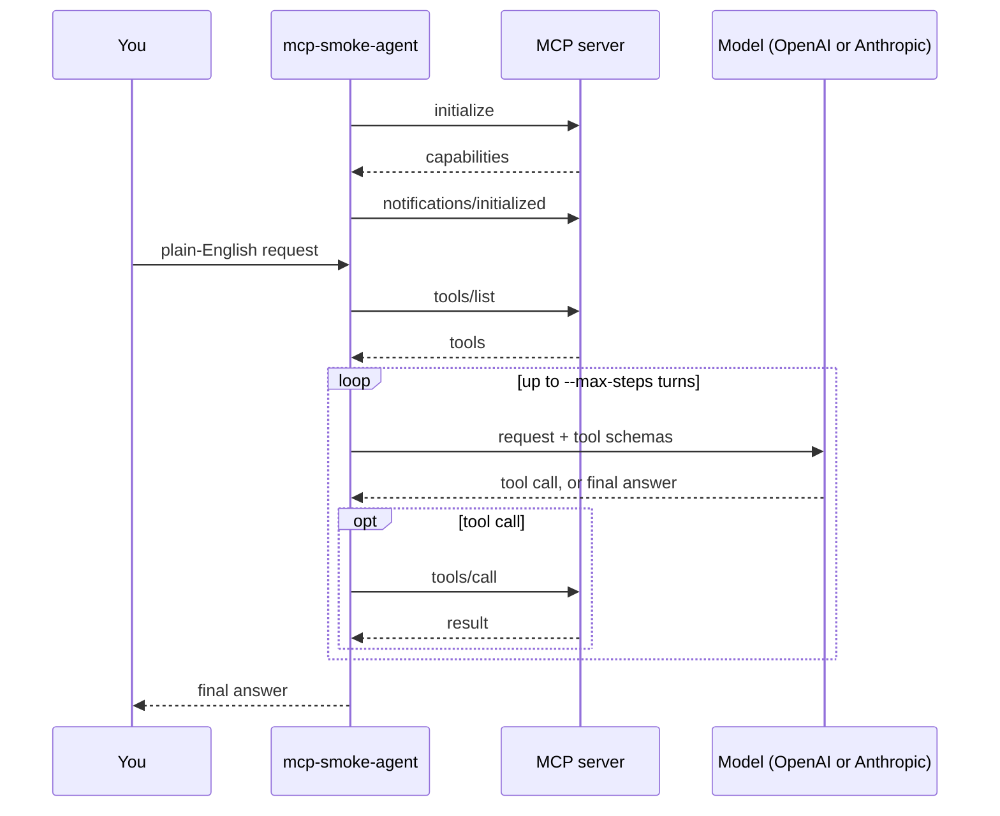

# How it works

## Agent mode

For each request, the CLI keeps a model and an MCP server talking through it:

Details that matter when you rely on it:

- The CLI refuses to continue if the server does not advertise the `tools` capability or returns no tools.
- The tool list is fetched again for every prompt, so a server that changes its tools between prompts is picked up.
- The model is told to use the provided MCP tools when they match, not to invent tools or arguments, to say so when no tool fits, and to answer briefly after tool calls.
- Tool results go back to the model as text, so the final answer reflects what the server actually returned.
- Each call is logged on stderr as `tool> name {json}`, which makes it easy to assert on in tests.

## Smoke mode

Smoke mode uses the same MCP client but no model. See [what it checks](smoke-mode.md#what-it-checks).

## Source layout

| Path | Role |
| --- | --- |
| `cmd/mcp-smoke-agent` | The CLI entry point. Routes `smoke` to smoke mode and everything else to agent mode. |
| `internal/agentcli` | Agent-mode flags, server specs, provider config and the interactive loop. |
| `internal/agent` | The OpenAI and Anthropic tool-calling loops. |
| `internal/smokecli` | Smoke-mode flags, steps and the JSON report. |
| `internal/mcp` | The MCP client for stdio and Streamable HTTP. |
| `cmd/mcp-test-server` | The bundled test server. |
