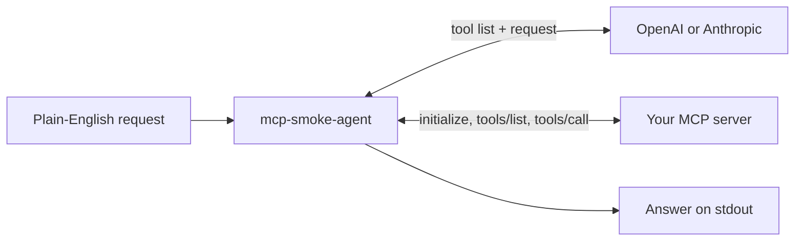

## How a request flows

## Start here

  <a class="home-path" href="./install">
    <strong>Install</strong>
    Get the CLI with <code>go install</code>.
  </a>
  <a class="home-path" href="./quick-start">
    <strong>Run your first request</strong>
    Add an API key and call a tool on the bundled test server.
  </a>
  <a class="home-path" href="./smoke-mode">
    <strong>Check protocol behaviour</strong>
    Raw MCP checks with a machine-readable JSON report.
  </a>
  <a class="home-path" href="./e2e">
    <strong>Wire it into CI</strong>
    See how this repository runs its own end-to-end check.
  </a>

