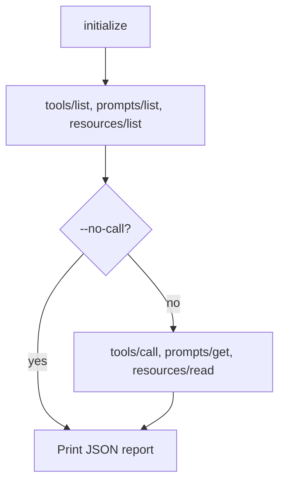

# Low-level smoke mode

If you want raw MCP protocol checks without an LLM, use:

```bash
mcp-smoke-agent smoke [flags]
```

No API key is needed. The command initializes MCP, lists the server's capabilities, and can optionally call tools, prompts or resources directly.

## Examples

```bash
mcp-smoke-agent smoke --transport=http --url http://localhost:3000/mcp
mcp-smoke-agent smoke --transport=stdio --command ./your-mcp-server -- <args>
```

Arguments after `--` are passed to the stdio command.

## What it checks



Each list step runs only if the server advertised that capability during `initialize`; otherwise the step is recorded as skipped, which counts as passing. Unless `--no-call` is set, the command then exercises one tool, one prompt and one resource:

- **Tool:** the one named by `--tool-name`, or else the first tool whose required arguments are all present in `--tool-args`. If `--tool-name` is given but required arguments are missing, the step fails. If no tool matches, the step is skipped.
- **Prompt:** chosen the same way from `--prompt-name` and `--prompt-args`.
- **Resource:** `--resource-uri`, or else the first listed resource.

## Flags

| Flag | Default | Description |
| --- | --- | --- |
| `--transport` | | `stdio` or `http`. Inferred from `--url` or `--command` when omitted. |
| `--url` | | Streamable HTTP endpoint URL. |
| `--command` | | Stdio command to run. |
| `--timeout` | `15s` | Timeout per request. |
| `--no-call` | `false` | Skip the tool, prompt and resource calls. |
| `--protocol` | `2025-06-18` | MCP protocol version the client announces. |
| `--tool-name` | | Tool to call. |
| `--tool-args` | `{}` | JSON object passed to `tools/call`. |
| `--prompt-name` | | Prompt to get. |
| `--prompt-args` | `{}` | JSON object passed to `prompts/get`. |
| `--resource-uri` | | Resource URI to read. |

## The report

The command prints one JSON document to stdout:

| Field | Meaning |
| --- | --- |
| `ok` | `true` when every step passed or was skipped. |
| `transport`, `url`, `command`, `args` | How the server was reached. |
| `protocol_version` | The protocol version the server returned from `initialize`. |
| `capabilities` | The capabilities the server advertised. |
| `steps` | One entry per step: `name`, `ok`, `skipped`, `duration_ms`, `error` and `detail`. |
| `started_at`, `finished_at`, `duration_ms` | Timing for the whole run. |

Step names are `initialize`, `tools/list`, `prompts/list`, `resources/list`, `tools/call`, `prompts/get` and `resources/read`. If the client cannot even start, the report contains a single `startup` step with the error.

## Exit codes

| Exit code | Meaning |
| --- | --- |
| `0` | `ok` is `true`. |
| `1` | At least one step failed, or the client could not start. |
| `2` | Invalid flags. |

That makes smoke mode easy to use in CI: the exit code gates the job and the JSON explains failures.
